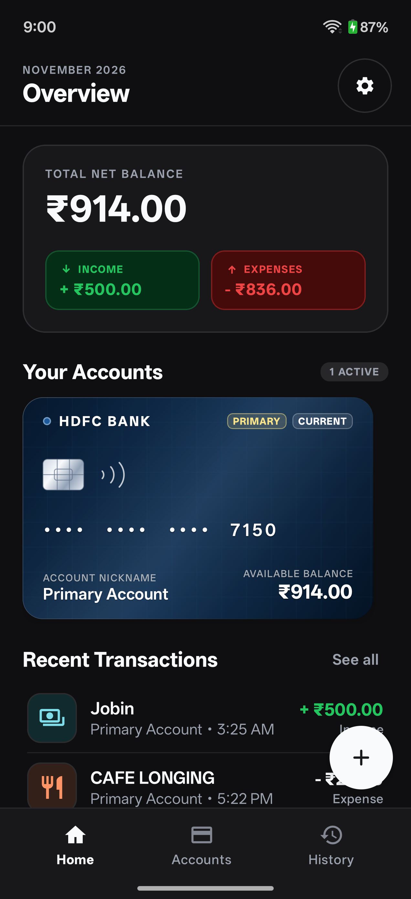
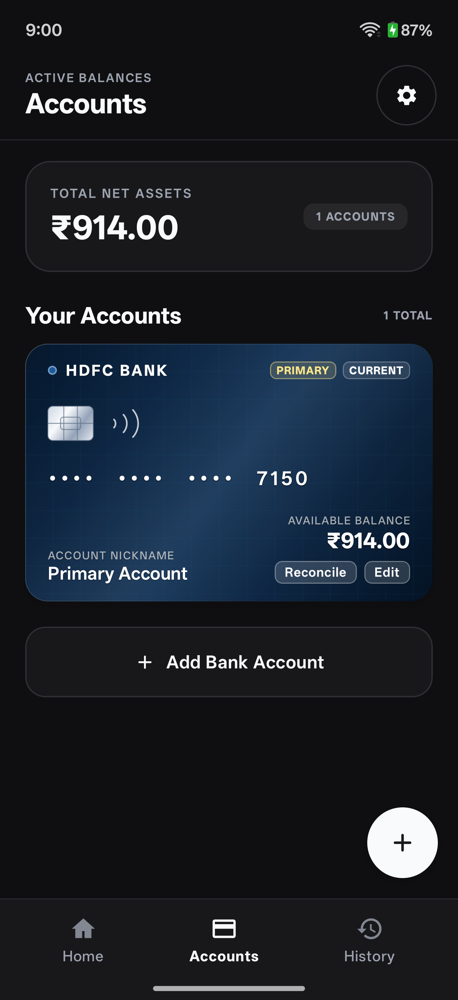
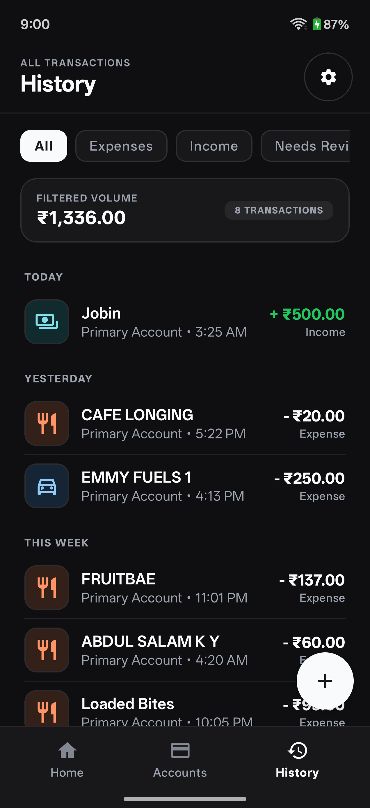
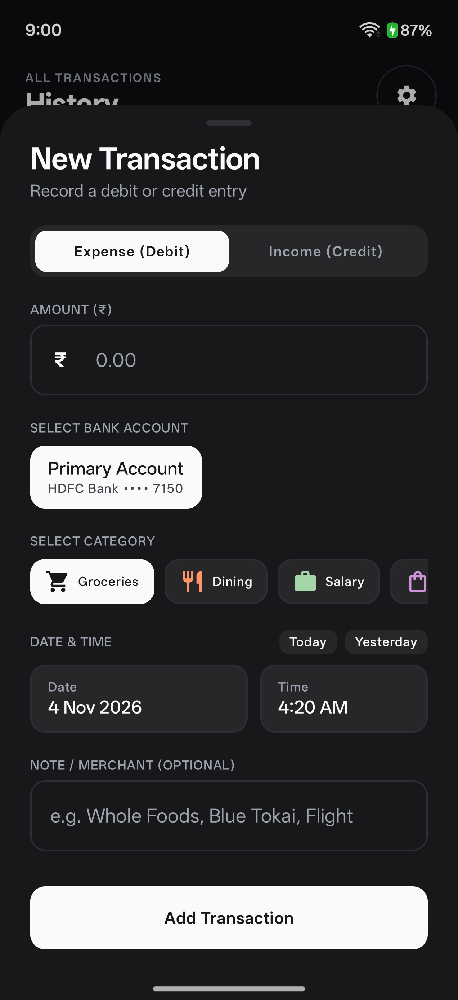
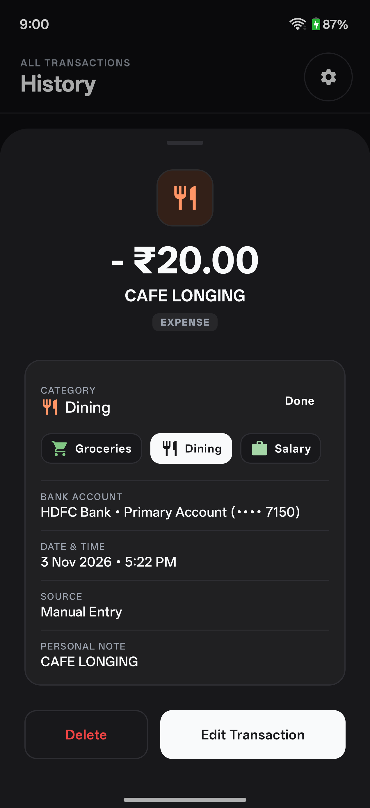
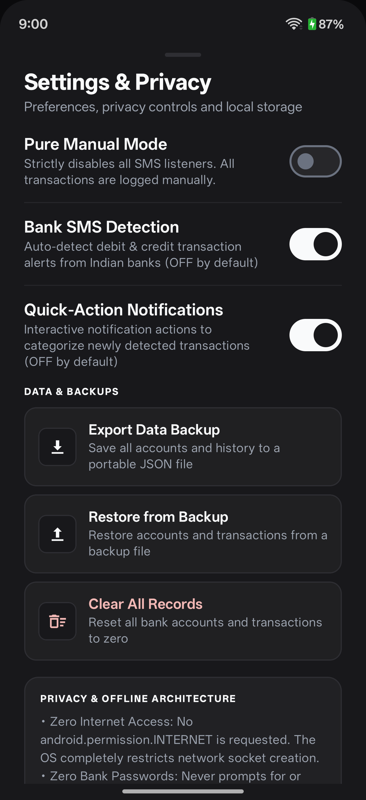
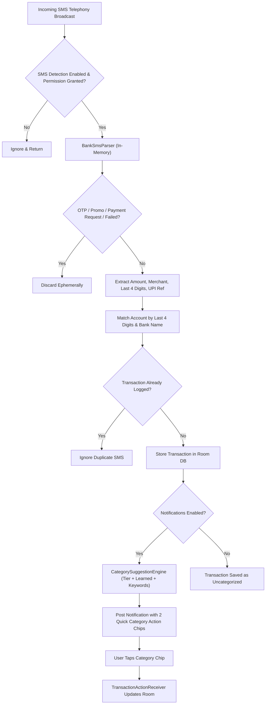

# Paisa

> Private, frictionless, and offline-first personal expense tracking for Android.

[-3DDC84?logo=android&logoColor=white)](https://developer.android.com)
[](https://kotlinlang.org)
[](https://developer.android.com/jetpack/compose)
[-000000)](#privacy-first--offline-by-design)
[-informational)](#license)

---

## Overview

**Paisa** is an open-source, local-first personal finance and expense manager for Android. It is engineered from the ground up around a strict privacy model: **zero internet permissions**, **zero remote servers**, and **zero tracking**.

Managing finances should never require handing over bank credentials or uploading bank transaction feeds to cloud servers. Paisa tracks income and expenses through fast manual entry or automated incoming bank SMS transaction alerts, processed entirely on-device in volatile memory.

---

## Why I Built Paisa

Most modern personal finance apps fall into two problematic categories:
1. **Cloud-dependent aggregators** that require bank account login credentials, cloud data synchronization, and consent to monetize or analyze your transaction history.
2. **Pure manual trackers** that offer strong privacy but require you to open the app and manually key in every single cup of coffee, grocery run, or UPI payment—a chore that quickly leads to tracking fatigue and abandoned apps.

Paisa strikes the ideal balance on Android:
- **Zero Friction**: Automatically captures incoming bank debit and credit SMS alerts as they happen, presenting instant 1-tap categorization action buttons in the notification shade.
- **Absolute Privacy**: The application does not declare the `android.permission.INTERNET` permission in its manifest. The Android OS prevents the app from creating network sockets. Your financial data stays entirely on your physical device.

---

## Screenshots

> *Screenshots captured on Android 15 using synthetic demo data. See [docs/screenshots/README.md](docs/screenshots/README.md) for emulator capture guidelines.*

| Dashboard | Bank Accounts | Ledger History |
| :---: | :---: | :---: |
|  |  |  |

| Add Expense | 1-Tap Categorization | Settings & Privacy |
| :---: | :---: | :---: |
|  |  |  |

---

## Features

### 1. Financial Ledger & Precise Math
- **Integer Arithmetic**: All monetary values are computed and stored as 64-bit integer paise (`Long`). Floating-point arithmetic is strictly avoided to eliminate currency rounding drift.
- **Multi-Account Tracking**: Manage multiple bank accounts across savings, salary, current, and credit cards with an enforced single primary account.
- **Account Reconciliation**: Keep your digital ledger aligned with your actual bank balance using dedicated balance adjustments.

### 2. Realistic Bank Cards & Minimalist UI
- **Realistic Card Textures**: Account cards feature authentic metallic smart chips, contactless indicators, brand gradient palettes, and embossed typography.
- **Supported Bank Presets**: Out-of-the-box presets for State Bank of India (SBI), HDFC Bank, Axis Bank, ICICI Bank, Kotak Mahindra, Federal Bank, Canara Bank, South Indian Bank, IDFC FIRST Bank, and Custom/Other accounts.
- **Monochrome Dark Aesthetic**: Minimalist, OLED-friendly dark theme designed with high-contrast Material 3 surfaces.
- **Material Symbols Rounded**: 22 native vector icons for transaction categories. Zero emoji characters in transaction metadata or UI controls.

### 3. Automated Bank SMS Detection (Opt-in)
- **Zero-Friction Logging**: Optionally captures incoming bank debit and credit SMS broadcasts via `android.permission.RECEIVE_SMS`.
- **Deterministic Multi-Stage Parser**: Extracts amount, merchant/beneficiary, and last 4 digits for major Indian banks.
- **Smart Category Heuristics**: Deterministic offline suggestion engine using amount brackets, learned merchant preferences, and keyword matching.
- **Smart Deduplication**: Cryptographic deduplication keys prevent duplicate transaction entries caused by SMS retries or dual bank/UPI messages.

### 4. Interactive Quick-Categorization Notifications (Opt-in)
- **1-Tap Action Chips**: When a bank SMS arrives, a high-priority notification appears displaying the top 2 suggested categories (e.g. *Food*, *Shopping*). Tapping a category assigns it instantly without launching the app.
- **In-Place Category Picker**: A "More" action launches a lightweight transparent picker dialog for quick selection of any category.

### 5. Privacy & Data Ownership
- **Hide Balances**: Mask sensitive total net worth and account figures with `••••` when using the app in public spaces.
- **Manual-Only Mode**: Completely turn off SMS detection and background receivers at any time.
- **Local JSON Backup & Restore**: Export your complete database (accounts, categories, transactions, preferences) to human-readable JSON via Android Storage Access Framework (SAF), and restore it seamlessly.

---

## Privacy-First & Offline by Design

Paisa is architected around strict cryptographic and sandbox principles:

1. **No Network Access**: Paisa does not declare `android.permission.INTERNET` or `android.permission.ACCESS_NETWORK_STATE`. The operating system prevents any network communication.
2. **Ephemeral SMS Processing**: The `SmsReceiver` reads incoming messages strictly in-memory. The parsed transaction entity is saved, and the raw SMS text is immediately discarded. Full SMS messages are never written to disk or logged.
3. **Strict OTP & Spam Rejection**: One-time passwords (OTPs), authentication codes, promotional spam, payment collection requests, and failed transaction notices are filtered out and dropped.
4. **No Full Card or Account Numbers**: Paisa never prompts for or stores 16-digit card numbers, netbanking passwords, CVVs, or account credentials. Only the last 4 digits (e.g. `1234`) are stored for matching.
5. **Private App Sandbox**: All data is stored in internal SQLite storage (`/data/data/com.example.paisa/databases/paisa_database.db`) protected by Android OS sandboxing and Linux filesystem permissions.

Read our complete [Privacy Policy](PRIVACY.md) and [Security Policy](SECURITY.md) for technical specifics.

---

## How SMS Detection & Category Notifications Work



---

## Android Permissions

| Permission | API Level | Purpose | Safety Guarantees |
|---|---|---|---|
| `android.permission.RECEIVE_SMS` | All | Listens for incoming bank debit and credit SMS alerts. | **Opt-in only**. Ephemeral in-memory parsing. Never reads SMS inbox (`READ_SMS` not requested). Never sends SMS (`SEND_SMS` not requested). Never stores raw SMS text. |
| `android.permission.POST_NOTIFICATIONS` | 33+ (Android 13+) | Displays interactive categorization notification chips for detected transactions. | **Opt-in only**. Processed locally via internal broadcast receivers. Never sends marketing notifications or cloud push messages. |

---

## Tech Stack

- **Language**: [Kotlin](https://kotlinlang.org) 2.2
- **UI Framework**: [Jetpack Compose](https://developer.android.com/jetpack/compose) with Material 3 (Compose BOM 2026.02.01)
- **Architecture**: MVI / MVVM with unidirectional data flow (UDF), Kotlin Coroutines, and `StateFlow`
- **Database**: [Room](https://developer.android.com/training/data-storage/room) 2.7.2 with SQLite and integer paise financial math
- **Preferences**: [Jetpack DataStore Preferences](https://developer.android.com/topic/libraries/architecture/datastore) 1.1.1
- **File Management**: Android Storage Access Framework (SAF) for local JSON import/export
- **Build System**: Gradle 9.4.1 with Android Gradle Plugin (AGP) 9.2.1 and Kotlin Symbol Processing (KSP)

---

## Project Structure

```
Paisa/
├── .github/
│   ├── ISSUE_TEMPLATE/
│   │   ├── bug_report.yml               # Structured bug reporting form
│   │   └── feature_request.yml          # Feature suggestion form
│   ├── workflows/
│   │   └── android-ci.yml               # GitHub Actions CI workflow
│   └── PULL_REQUEST_TEMPLATE.md         # Pull request checklist & guide
├── app/
│   ├── src/
│   │   ├── main/
│   │   │   ├── java/com/example/paisa/
│   │   │   │   ├── data/
│   │   │   │   │   ├── backup/          # Offline JSON backup and restore (SAF)
│   │   │   │   │   ├── local/           # Room database, entities, DAOs, converters
│   │   │   │   │   ├── model/           # Data models (AccountWithBalance, MonthlyTotals)
│   │   │   │   │   ├── preferences/     # DataStore UserPreferences
│   │   │   │   │   └── repository/      # Financial ledger repository
│   │   │   │   ├── model/               # Bank presets & CategoryIconRegistry
│   │   │   │   ├── notification/        # Interactive notification helper & category picker
│   │   │   │   ├── parser/              # Bank SMS parser regexes & deduplication logic
│   │   │   │   ├── sms/                 # SMS broadcast receiver, matcher & suggestions
│   │   │   │   ├── ui/                  # Compose screens, components, viewmodels & theme
│   │   │   │   ├── util/                # CurrencyFormatter & DateFormatter
│   │   │   │   └── MainActivity.kt      # Main activity, navigation & sheet coordination
│   │   │   ├── res/                     # Vector drawables, colors, strings & themes
│   │   │   └── AndroidManifest.xml      # Zero INTERNET manifest declaration
│   │   └── test/                        # 129+ unit tests (parsers, DAOs, models, backups)
│   └── build.gradle.kts                 # Application Gradle configuration
├── docs/
│   └── screenshots/                     # Screenshot assets and capture guidelines
├── CHANGELOG.md                         # Release history (Keep a Changelog)
├── CODE_OF_CONDUCT.md                  # Contributor Covenant v2.1
├── CONTRIBUTING.md                     # Development, testing, and PR guidelines
├── PRIVACY.md                           # Detailed privacy architecture
├── README.md                            # Project documentation
└── SECURITY.md                          # Vulnerability reporting policy
```

---

## Installation & Local Build

### Prerequisites
- **JDK**: Java 17 or Java 21
- **Android SDK**: Build Tools 36, Platform API 36 (`minSdk = 26`)
- **Android Studio**: Android Studio Meerkat (2024.3+) or Ladybug+

### Steps
1. Clone the repository:
   ```bash
   git clone https://github.com/<your-username>/Paisa.git
   cd Paisa
   ```

2. Open the project in Android Studio or build via command line:
   ```bash
   # Make gradlew executable
   chmod +x gradlew

   # Run automated unit test suite
   ./gradlew testDebugUnitTest

   # Assemble debug APK
   ./gradlew assembleDebug
   ```

3. The compiled debug APK will be located at:
   ```
   app/build/outputs/apk/debug/app-debug.apk
   ```

4. Install directly to a connected Android device or emulator:
   ```bash
   adb install -r app/build/outputs/apk/debug/app-debug.apk
   ```

---

## Usage Guide

1. **Onboarding**: On initial launch, Paisa introduces its zero-internet, offline-first philosophy. Choose whether to enable SMS transaction detection and categorization notifications (both optional and disabled by default).
2. **Add Your Accounts**: Go to the **Accounts** tab and tap **Add Bank Account**. Select your bank chip, enter a nickname (e.g. *Salary Account*), the last 4 digits of your account or debit card, and your opening balance.
3. **Record Spends**:
   - **Automatic**: When an SMS arrives from your bank for a debit or credit, Paisa detects it, updates your balance, and displays a notification with 2 suggested category chips. Tap a chip to categorize immediately.
   - **Manual**: Tap the `+` button on the Home screen, enter the amount, select an account and category, and save.
4. **Reconcile**: If your physical bank statement differs from your recorded ledger, tap **Reconcile** on the account card to adjust your ledger balance.
5. **Backup Your Data**: Open **Settings** $\rightarrow$ **Export Backup** to save a JSON copy of your accounts, transactions, and categories to your chosen storage location.

---

## Known Limitations

- **Bank SMS Format Variations**: Indian banks periodically update their SMS alert wording and sender IDs. While Paisa includes test-backed parsers for major banks, unrecognized formats will fail to parse and require pattern additions.
- **OEM Battery Optimizations**: Certain Android OEM skins (e.g. MIUI, ColorOS, OxygenOS) aggressively terminate background broadcast receivers. To ensure reliable SMS detection, ensure battery optimization for Paisa is set to "Unrestricted" in device settings.
- **Unencrypted SQLite at Rest**: The local database relies on Android app sandbox permissions and device-level File-Based Encryption (FBE). Application-level database encryption (SQLCipher) is planned for a future release.
- **Single-Device Operation**: Because Paisa has zero network access, data does not automatically sync between multiple devices. Use the local JSON export/import feature to transfer data between devices.

---

## Roadmap

- [ ] **Database Encryption at Rest**: Integrate SQLCipher or Android Keystore for application-level SQLite encryption.
- [ ] **Biometric App Lock**: Fingerprint and Face Unlock security upon launching the app.
- [ ] **Expanded Bank SMS Parsers**: Community-contributed regex patterns for regional, cooperative, and neo-banks.
- [ ] **Spending Analytics & Visuals**: Category breakdown charts, monthly comparison trends, and budget limits.
- [ ] **Recurring Bills & Subscriptions**: Track fixed monthly expenses and recurring payment dates.
- [ ] **CSV / Spreadsheet Export**: Export transaction records in standard CSV format for spreadsheet accounting.

---

## Contributing

Contributions are warmly welcomed! Please read our [Contributing Guidelines](CONTRIBUTING.md) and [Code of Conduct](CODE_OF_CONDUCT.md) before opening a pull request.

To propose bank SMS regex improvements, add synthetic test cases to [`BankSmsParserTest.kt`](app/src/test/java/com/example/paisa/parser/BankSmsParserTest.kt) without including real personal or financial details.

---

## Inspiration & Credits

Paisa was inspired by my friend **Jobin Biju** and his project **Finlogue**. His approach to understanding everyday spending encouraged me to explore a similar problem on Android, with a focus on local-first tracking, bank SMS detection, and quick categorization.

- Article: [I built an app to stop lying to myself](https://jobinbiju.substack.com/p/i-built-an-app-to-stop-lying-to-myself) by Jobin Biju
- Repository: [JobinBiju/Finlogue](https://github.com/JobinBiju/Finlogue)

*Note: Paisa is an independent native Android application built with Kotlin and Jetpack Compose, designed specifically for Android's SMS telephony broadcast architecture and Material 3 design system.*

---

## License

Paisa is an open-source project. The maintainer is currently selecting between the **Apache License 2.0** and the **MIT License**.

- Third-party icons: [Material Symbols](https://fonts.google.com/icons) licensed under the [Apache License 2.0](https://www.apache.org/licenses/LICENSE-2.0).
- Android Jetpack and Google libraries are licensed under Apache License 2.0.

See [LICENSE](LICENSE) (to be finalized upon release).
