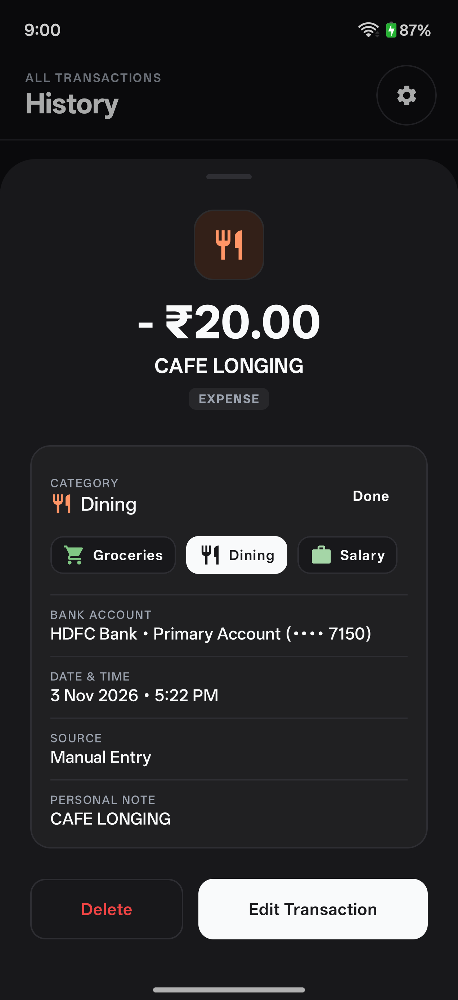
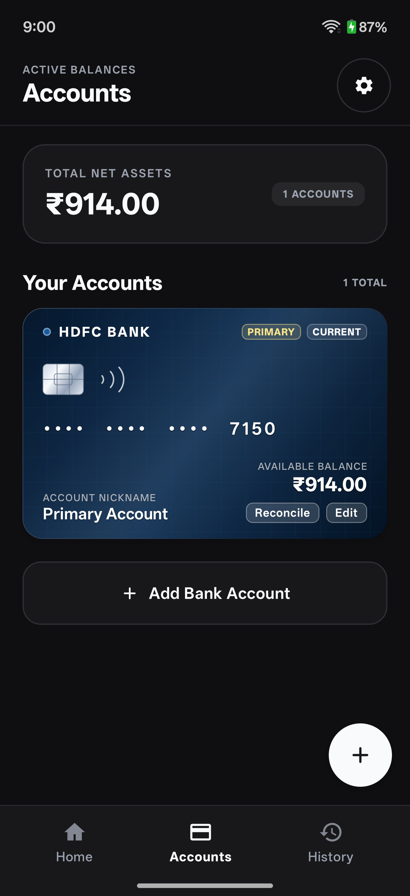
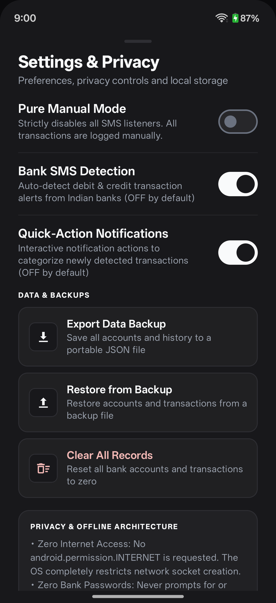
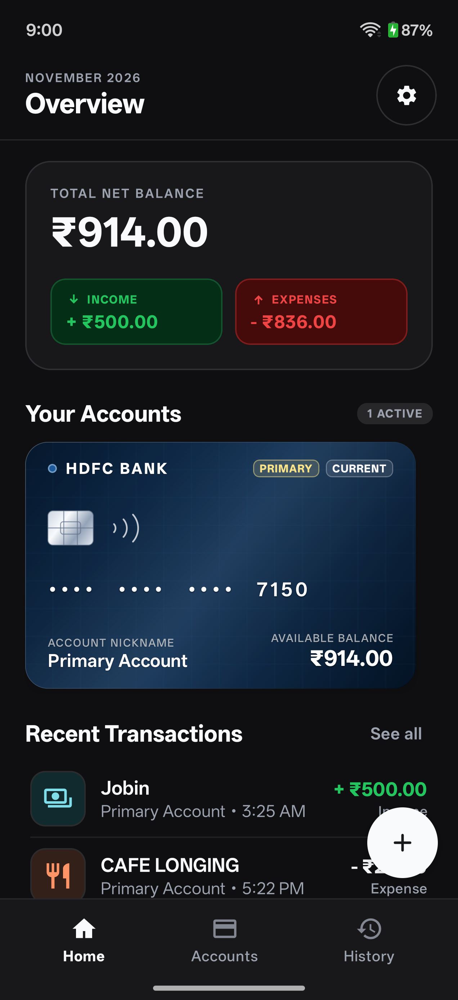

# Where Does My Money Go?

### Building Paisa, an offline-first Android expense tracker.

---

At the end of every month, I used to sit down with my bank statement and feel a quiet, disorienting knot in my stomach.

My salary had hit my account thirty days ago. I hadn't made any extravagant purchases. I hadn't bought a new laptop, booked a vacation flight, or indulged in an expensive gadget. Yet, looking at the closing balance on my screen, roughly ₹15,000 had simply evaporated into thin air.

Where did it all go?

In modern India, spending money has become eerily frictionless. A quick QR scan here for ₹40 chai and biscuits, a ₹180 tap for a quick coffee while waiting for a friend, ₹230 on a quick-commerce app because I ran out of milk, and ₹450 for dinner delivery on a lazy Tuesday evening. Because none of these transactions require opening a wallet, pulling out paper notes, or waiting for physical change, the human brain conveniently rounds them down to zero. You don't feel the weight of spending money anymore. You just feel the aftermath thirty days later.

I needed to fix this. But every tool I tried only made me feel worse.

---

### The Spark: A Friend's Honesty

Around that time, my friend **Jobin Biju** published a raw, reflective piece titled [*"I built an app to stop lying to myself"*](https://jobinbiju.substack.com/p/i-built-an-app-to-stop-lying-to-myself). 

Jobin wrote about the exact same psychological trap—the collective delusion we build around our daily spending—and how he decided to build an iOS app called [**Finlogue**](https://github.com/JobinBiju/Finlogue) to force himself into brutal, daily financial honesty. 

Reading Jobin’s story felt like someone holding up a mirror. He wasn't trying to build the next VC-backed fintech unicorn. He wasn't trying to sell insurance or pitch mutual funds. He just wanted a private, honest, friction-free way to understand his own spending patterns before the month slipped away.

I loved what Jobin built on iOS. But I am an Android engineer, and my daily driver is an Android device.

I wondered: *What would a personal expense tracker look like if it was built specifically for the realities of modern Android in India?*

---

### The Android Reality: A Broken Ecosystem

When I opened Google Play to find an existing Android expense tracker, the experience was borderline dystopian.

The popular "expense tracking" apps on Android fall almost universally into two buckets:

1. **The Manual Monoliths**: Beautiful, minimal apps that require you to unlock your phone, open the app, tap a floating action button, pick a category from twenty confusing dropdowns, type the number on an in-app keypad, and hit save. After three days of buying two coffees and three auto rides a day, the friction wins. You stop logging.
2. **The Data Harvesters**: "Automatic" apps that promise to read your bank SMS messages. But to do that, they ask for your phone number, require Google account login, upload your entire SMS inbox to their cloud servers, profile your credit limits, and immediately bombard you with notifications for pre-approved personal loans, credit card upgrades, and high-interest loans.

Think about that for a second. To answer the simple question *"Did I spend too much on lunch this week?"*, you have to hand over your bank balance, account numbers, and personal identity to a remote database owned by an ad company.

I wanted none of that. 

I made a single architectural commitment before writing the very first line of code:

> **Paisa will never request the `INTERNET` permission.**

If an Android application doesn't have `android.permission.INTERNET` declared in its `AndroidManifest.xml`, it is cryptographically impossible for the app to send data anywhere outside the physical device. No telemetry, no third-party analytics SDKs, no tracking pixels, and no remote servers. Everything happens strictly inside the phone.

---

### Designing for Frictionlessness

The biggest lesson I took from Jobin was that **friction kills tracking habits**. If an app asks too much of you in the moment of transaction, you will abandon it.

On Android, we have a unique superpower that iOS doesn't easily afford: broadcast receivers for incoming bank SMS alerts (`android.permission.RECEIVE_SMS`) and rich interactive notifications (`android.permission.POST_NOTIFICATIONS`).

Every time you pay with UPI, an ATM card, or net banking in India, your bank sends an instant SMS alert within three seconds:

> *"Rs 280.00 debited from A/C XX4821 on 25-Oct-26 at BLUE TOKAI. Avail Bal: Rs 42,150.00."*

Here is how Paisa turns that alert into zero-friction tracking:

1. **In-Memory Parsing**: The moment the broadcast arrives, Paisa's parser runs in memory. It strips out the transaction amount, payment channel (UPI, Card, ATM), masked account digits (`4821`), and payee name (`Blue Tokai`).
2. **Strict Privacy**: Raw SMS text is discarded immediately. It is never written to disk, never logged, and never stored.
3. **One-Tap Categorization from the Lock Screen**: A notification pops up with the exact amount and merchant, accompanied by two smart offline category chips (e.g., `[☕ Coffee]` and `[🛒 Groceries]`). 
4. **Done in Two Seconds**: You tap `[☕ Coffee]` straight from your notification bar without even unlocking your phone or opening the app. The background receiver tags the transaction in your local Room database, and the notification quietly dismisses itself.

If you don't feel like tagging it right then, that's fine too. The transaction is safely recorded as pending, ready for you whenever you feel like reviewing your day.

---

### Making Finances Feel Tactile

Most personal finance apps look like glorified spreadsheets. Rows of gray numbers, generic blue buttons, and sterile graphs.

I wanted Paisa to feel satisfying to look at. When you open an app that handles something as emotionally charged as your money, the UI should feel calm, tactile, and intentional.

Using **Jetpack Compose**, I built realistic bank account cards that mirror the physical cards sitting in your wallet:

Each bank preset has its own distinct identity:
- **HDFC Bank**: Deep navy with subtle silver foil accents and geometric grid engraving.
- **State Bank of India (SBI)**: Classic institutional blue with metallic gold chip highlights.
- **Axis Bank**: Rich burgundy with chevron embossing.
- **ICICI Bank**: Warm terracotta tones with sunburst patterns.

Every card displays your masked account number (`•••• 7150`) and your real-time calculated balance. When you hand your phone to a colleague or use it on a crowded metro, a single tap on the **Hide Balances** toggle discreetly masks every balance with clean privacy pills:

---

### The Unseen Edge Cases of Banking SMS

Building an SMS parser sounds deceptively simple on paper: just match a few regexes for `debited` and `credited`, right?

In practice, parsing Indian bank SMS is a masterclass in edge cases:

- **The Float Bug**: Storing money as floating-point numbers (`Double` or `Float`) in software is a recipe for silent accounting drift. In Paisa, every single rupee is converted and stored as a 64-bit integer of **paise** (`₹1,450.50` = `145050L`). Zero rounding errors, guaranteed financial integrity across decades of records.
- **Promotional Spam**: Banks love sending promotional marketing alerts that look terrifyingly like credits:  
  *"Congratulations! Your Card ending 7150 is credited with 500 Reward Points. Claim voucher worth Rs 500 now at..."*  
  Early on, the parser matched `credited` and `500` and recorded a phantom ₹500 credit in the user's dashboard! I had to build a dedicated heuristics layer to detect and discard vouchers, gift cards, coupons, CashPoints, and promotional offers upfront.
- **Unmatched Cards**: If you have a primary card registered (`*7150`), and you make a payment using a different unadded card (`*4821`), early prototypes lazily dumped that expense into your primary card. That polluted the balance. The solution was dynamic discovery: Paisa detects the new card digits from the bank header, auto-provisions an isolated account for `•••• 4821`, and records the transaction without ever corrupting your primary card.

---

### What I've Learned

Building Paisa has changed the way I think about software:

1. **Offline-first is liberating.** Building an app with zero backend servers is pure joy. There are no AWS bills at the end of the month, no database migrations failing on remote clusters, no user authentication tokens expiring, and no security breach nightmares. The user's device is their own sanctuary.
2. **Small frictions are big barriers.** If logging an expense requires four taps and a loading spinner, people won't do it. If it takes one tap from a lock screen notification, it turns into an unconscious, satisfying habit.
3. **Open source builds trust.** When it comes to personal finance, nobody should take a developer's word for granted. Paisa is fully open source. Anyone can inspect the code, verify that `INTERNET` permission is absent, compile the APK themselves, and know with 100% certainty that their financial data never leaves their pocket.

---

### Final Thoughts

I didn't build Paisa to change the world or disrupt an industry. I built it because I was tired of wondering where my paycheck vanished every month, and I was even more tired of invasive finance apps treating my personal spending habits as inventory to sell to advertisers.

Big thanks to my friend **Jobin Biju** for sparking this journey with [Finlogue](https://github.com/JobinBiju/Finlogue). Sometimes, all it takes to solve a stubborn problem is seeing a peer face it honestly and realizing that you can build the answer yourself.

If you are an Android user struggling with the same quiet leaks in your everyday spending, you can explore the project or download the signed APK directly from GitHub:

👉 **[Paisa on GitHub](https://github.com/SuvarneshKM/paisa)**

Own your data. Understand your spending. Stop lying to yourself.
